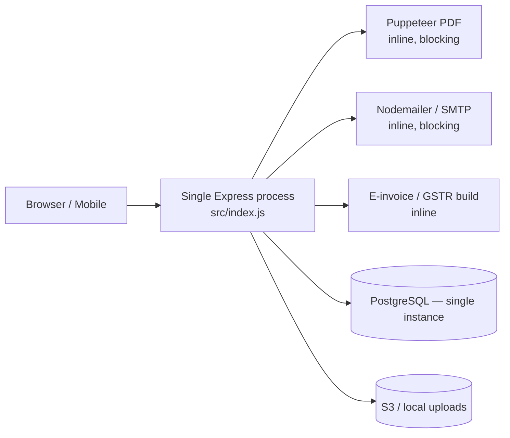
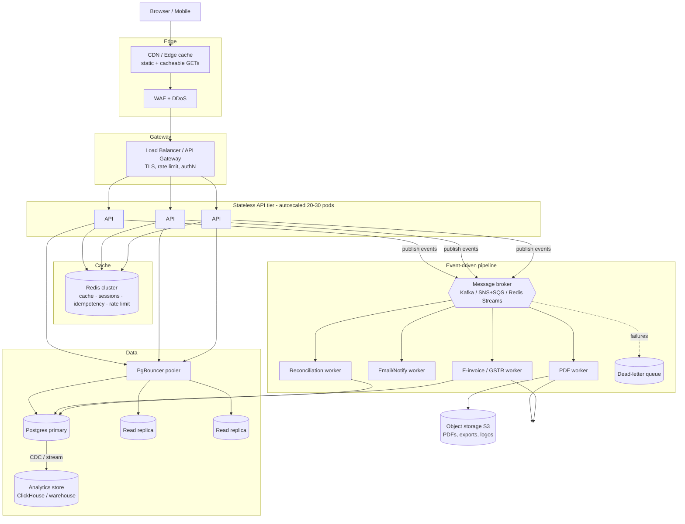

# ⚡ Scalability, Reliability & Event-Driven Design — GST Compliance SaaS

> **Purpose:** Answer the question *"Can this platform reliably serve ~10,000 TPS at low latency?"* and give a concrete, staged blueprint to get there using a **horizontally-scaled, cache-backed, event-driven (pub/sub)** architecture.
>
> **Audience:** Engineers evolving this MVP toward production scale. Read alongside [`PRODUCTION-DEPLOYMENT-AND-PUBLISHING.md`](PRODUCTION-DEPLOYMENT-AND-PUBLISHING.md).

---

## 0. TL;DR — The honest verdict

**Can the current codebase handle 10,000 TPS today? No.**

The MVP is a **single-process, synchronous** Node/Express API talking to **one PostgreSQL instance**, doing heavy work *inline on the request thread* (Puppeteer PDF generation, email sending, e-invoice/GSTR building), with **no cache in the hot path**, **no connection pooler**, and **no message queue**. It is correct and demoable, but it will saturate long before 10k TPS.

**Can it get there? Yes — with a well-understood set of changes**, none of which require rewriting business logic:

1. Make the API tier **stateless and horizontally scalable** behind a load balancer + autoscaler.
2. Put a **cache (Redis)** in front of hot reads and add a **connection pooler (PgBouncer)** + **read replicas** for Postgres.
3. Move every heavy/slow operation **off the request path** into an **event-driven pub/sub pipeline** (broker + worker consumers) with idempotency, retries, and dead-letter queues.
4. Add **observability, SLOs, backpressure, and resilience patterns** (timeouts, circuit breakers, bulkheads).
5. **Load-test** continuously (k6) against explicit latency budgets.

The rest of this document is the blueprint.

---

## 1. What "10,000 TPS" actually demands

"10k TPS" is meaningless without a workload shape. Define it first, because the architecture follows from it.

### 1.1 Traffic assumptions (example, tune to reality)
| Dimension | Assumption |
|---|---|
| Total | 10,000 requests/sec sustained, ~3× burst (30k) |
| Read : Write mix | ~85% reads (dashboards, lists, lookups) / ~15% writes |
| Heavy async ops | PDF, email, e-invoice, GSTR gen, reconciliation ≈ 1–3% of writes |
| Payload | Mostly small JSON (< 20 KB); PDFs/exports are large but async |
| Tenancy | Multi-tenant; traffic **partitionable by `businessId`** |

### 1.2 Latency budget (target SLOs)
| Class | Target p50 | Target p99 |
|---|---|---|
| Cached read (GET list/summary) | < 15 ms | < 80 ms |
| Uncached read (single row) | < 30 ms | < 150 ms |
| Write (create invoice/customer) | < 60 ms | < 250 ms |
| Async job perceived (accepted → done) | seconds | < 30 s |

### 1.3 Capacity math (back-of-envelope)
- If a single Node API instance safely serves **~1,000–2,000 RPS** of light JSON at p99 < 150 ms (realistic for Express with a warm cache and no blocking work), then **10k TPS ⇒ ~8–15 API instances** + headroom for bursts ⇒ plan for **~20–30 instances** with autoscaling.
- **8,500 reads/sec**: serve ~80–90% from Redis ⇒ only ~1–2k reads/sec hit Postgres replicas. A small replica fleet (2–4) handles this comfortably.
- **1,500 writes/sec**: the primary Postgres must sustain this. With batching, proper indexes, and short transactions a well-tuned primary handles it; beyond that, **shard/partition by tenant**.
- **Heavy ops** (say 15–45/sec of PDF/e-invoice): never on the request thread — a **worker pool of N consumers** scales independently.

> Rule of thumb: **the request path must do only cheap, bounded work** (validate → cache/DB read or a single short write → enqueue event → return). Everything expensive is asynchronous.

---

## 2. Current architecture & bottleneck analysis (be honest)

### Bottlenecks that break at scale
| # | Bottleneck | Why it hurts at 10k TPS | Fix (section) |
|---|---|---|---|
| B1 | **Single API process** | One event loop; CPU-bound work (PDF) stalls *all* requests | §3, §5 |
| B2 | **Blocking heavy work on request path** (Puppeteer, email, e-invoice) | Each such request can occupy the loop for 100s of ms–seconds → tail latency explosion, timeouts | §5 (event-driven) |
| B3 | **Puppeteer/Chromium per request** | Huge memory + startup cost; not viable at volume | §5 (worker + pooled/browserless or template-based PDF) |
| B4 | **Single Postgres, no pooler** | Connection storms from many instances; read load competes with writes | §4 |
| B5 | **No cache** | Every dashboard/list hits the DB | §4.2 |
| B6 | **No queue / no retries** | Failures are lost; no backpressure; spikes hit DB directly | §5 |
| B7 | **Stateful assumptions** (local file uploads at `/uploads`) | Breaks across N instances | §3.3 |
| B8 | **N+1 query risk** in list/report endpoints | Amplifies DB load | §4.4 |
| B9 | **No observability/SLOs** | Can't see or defend latency; blind under load | §7 |
| B10 | **Synchronous webhooks/payments** | Razorpay/GST callbacks need idempotency + async processing | §5.4, §6.4 |

---

## 3. Target architecture (high level)

### 3.1 Principles
- **Stateless services**: no local session/file state → any instance serves any request → free horizontal scaling.
- **Cheap request path**: validate → cache/replica read *or* one short write → **publish an event** → respond `202 Accepted` for heavy work.
- **Everything expensive is asynchronous** and idempotent.
- **Partition by tenant (`businessId`)**: enables cache locality, ordered per-tenant processing, and future sharding.
- **Design for failure**: timeouts, retries with jitter, circuit breakers, bulkheads, DLQs, multi-AZ.

### 3.2 Compute & autoscaling
- Containerize the API (already deployable via Docker per the production guide). Run on **Kubernetes (HPA)** or **ECS/Fargate** / a PaaS with autoscaling.
- Scale on **RPS + p95 latency + CPU**, not CPU alone.
- Run **multiple Node processes per box** (cluster mode / one pod per core) since Node is single-threaded.
- **Graceful shutdown** (already have `SIGTERM` handling in `index.js`) → drain in-flight requests, stop consuming events, then exit.

### 3.3 Remove stateful coupling (must-fix from current code)
- Replace local `/uploads` static serving with **S3 + CDN** for all artifacts (the code already has an `s3Service` with a local fallback — make S3 the default in prod).
- Keep **JWT stateless** (already the case) or move sessions to Redis if you introduce server sessions.

---

## 4. Data layer: low latency at read scale

### 4.1 Connection pooling (do this first)
- Put **PgBouncer** (transaction pooling) between the API fleet and Postgres. Without it, 25 instances × Prisma pool = connection storm.
- Set Prisma `connection_limit` low per instance; let PgBouncer multiplex.

### 4.2 Caching (Redis) — the single biggest latency win
- **Cache-aside** for hot reads: dashboard summary, lists, product/customer lookups, subscription/plan, HSN data.
- Key by tenant: `biz:{businessId}:dashboard:summary`. TTL 15–120 s for volatile, longer for near-static (HSN, plans).
- **Invalidate on write**: on invoice/customer/product mutation, delete/refresh the tenant's affected keys (publish a `cache.invalidate` event so all instances converge).
- Use Redis also for **rate limiting**, **idempotency keys**, and **hot counters**.
- Redis is already a dependency (`ioredis`) and in `docker-compose` — wire it into the read paths.

### 4.3 Read replicas + read/write splitting
- Route **reads to replicas**, **writes to primary**. Prisma supports multiple datasources / the read-replica extension, or do it at PgBouncer/proxy level.
- Watch **replication lag**: for read-your-writes consistency (e.g., just-created invoice), read that one from primary or from cache.

### 4.4 Query hygiene (eliminate B8)
- Audit list/report endpoints for **N+1**; use Prisma `select`/`include` deliberately and **paginate with keyset (cursor) pagination**, not large `OFFSET`.
- Ensure indexes exist for every hot filter (`businessId`, dates, status) — the schema already indexes these; verify with `EXPLAIN ANALYZE` under load.
- Keep transactions **short**; never hold a transaction open across a network/IO call.

### 4.5 Reports & analytics (offload heavy aggregation)
- Dashboards/reports over large ranges should **not** aggregate live on the OLTP primary at 10k TPS.
- Options: **materialized views** refreshed on a schedule/event, or stream changes (CDC via Debezium) into an **OLAP store (ClickHouse / BigQuery / Redshift)** and serve analytics from there (CQRS read model).

### 4.6 Sharding / partitioning (when a single primary isn't enough)
- Multi-tenant data partitions cleanly by `businessId`.
- Start with **table partitioning** (by month for invoices/purchases; by tenant for the biggest tables).
- If writes exceed a single primary, **shard by tenant** (hash `businessId` → shard). Keep a routing map; avoid cross-shard queries.

---

## 5. Event-driven / pub-sub design (the core of scaling)

Move slow, failure-prone, or spiky work out of the request path. The request records intent (a small write + an event), returns immediately, and **workers** do the rest.

### 5.1 Choosing a broker
| Option | Use when | Trade-offs |
|---|---|---|
| **AWS SNS + SQS** | You're on AWS, want managed, simple fan-out + queues, DLQ built-in | Easiest ops; per-message ordering only with FIFO queues |
| **Apache Kafka** (or MSK / Redpanda) | High throughput, event replay, ordered per-partition, stream processing, CDC | More ops complexity; best for 10k+ TPS event volume |
| **RabbitMQ** | Rich routing, moderate scale, work queues | Manual scaling/HA |
| **Redis Streams** | You already run Redis, moderate scale, simple | Fewer durability/replay guarantees than Kafka |

**Recommendation:** **Kafka** (or MSK/Redpanda) if you need replay/ordering/CDC and true 10k-scale event volume; **SNS+SQS** if you want managed simplicity on AWS. Partition/route by **`businessId`** so a tenant's events process in order.

### 5.2 Event catalog (map current inline work → events)
| Trigger (request path) | Event published | Consumer(s) | Replaces current inline work |
|---|---|---|---|
| Create invoice | `invoice.created` | PDF worker, e-invoice worker, inventory worker, insights refresh | Inline PDF/e-invoice (B2/B3) |
| Request PDF | `invoice.pdf.requested` | PDF worker → S3, then `invoice.pdf.ready` | Puppeteer inline |
| Send invoice email | `invoice.email.requested` | Email worker (SMTP/SendGrid) | Nodemailer inline |
| Generate GSTR-1/3B | `gst.return.requested` | GSTR worker (heavy build) → `gst.return.ready` | Inline build |
| Generate e-invoice IRN | `einvoice.requested` | E-invoice worker → IRP/GSP call → `einvoice.generated` | Inline provider call |
| Generate e-way bill | `ewaybill.requested` | EWB worker | Inline |
| Bank statement uploaded | `bank.statement.uploaded` | Reconciliation worker (auto-match) | Inline matching |
| Bulk CSV import | `import.requested` | Import worker (row-by-row, progress) | Inline parse/create |
| Payment webhook (Razorpay) | `payment.webhook.received` | Payment worker (verify, activate) | §5.4 |
| Any mutation | `audit.log` , `cache.invalidate` | Audit worker, all instances | Fire-and-forget already; formalize |
| WhatsApp/notify | `notify.requested` | Notification worker (WhatsApp Cloud API/email/SMS) | Link-only today |

### 5.3 Reliability patterns for the pipeline
- **Transactional Outbox**: within the same DB transaction that writes the invoice, write an `outbox` row; a relay publishes it to the broker. Guarantees "no lost events / no phantom events" (avoids dual-write bug).
- **Idempotency**: every event carries an `idempotencyKey` (e.g., `invoice:{id}:pdf`). Consumers dedupe (Redis SETNX or a processed-events table) so **at-least-once delivery** is safe.
- **Retries with exponential backoff + jitter**; cap attempts.
- **Dead-Letter Queue (DLQ)** for poison messages + an alert + a replay tool.
- **Ordering per tenant**: partition key = `businessId` so events for one tenant don't reorder (e.g., invoice created before its PDF).
- **Backpressure**: bounded queues; if consumers fall behind, the queue absorbs bursts instead of crashing the DB (B6 fixed).
- **Sagas** for multi-step flows (invoice → e-invoice → e-way bill) with compensating actions on failure.
- **Progress/status**: expose `GET /jobs/:id` (or per-entity status field) so the UI can poll or subscribe (WebSocket/SSE) for "PDF ready", "IRN generated".

### 5.4 Idempotent webhooks & payments (critical correctness)
- Razorpay/GST/IRP callbacks can arrive **multiple times** and **out of order**.
- Verify signature → store raw event with a unique id → **enqueue** → return 200 fast. Process asynchronously with idempotency so a replay doesn't double-activate a subscription.

### 5.5 PDF specifically (B3)
Puppeteer-per-request won't scale. Options, best first:
1. **Template-based PDF** (e.g., `pdfkit` — already a dep) in a worker: fast, low memory, no browser.
2. If HTML fidelity is required, a **pooled/remote Chromium** (a `browserless` service) consumed by the PDF worker, never the API.
3. Cache generated PDFs in S3; serve via CDN; regenerate only on change.

---

## 6. Reliability & resilience (staying up under load and failure)

### 6.1 Redundancy & availability
- **Multi-AZ** for API, Redis, Postgres (primary + standby with automatic failover), broker.
- **≥ 2 replicas** of every stateless service; **PodDisruptionBudgets**; rolling/canary deploys.
- **Health checks**: liveness (`/health` exists) + **readiness** (don't take traffic until DB/broker/cache reachable).

### 6.2 Failure isolation
- **Timeouts on every external call** (DB, Redis, broker, IRP/GSP, SMTP, Razorpay). No unbounded awaits.
- **Circuit breakers** (e.g., `opossum`) around flaky externals (GSTN IRP, WhatsApp) → fail fast, shed load, recover.
- **Bulkheads**: separate connection pools/worker groups so a slow e-invoice provider can't starve invoice creation.
- **Rate limiting & quotas** per tenant/API key (Redis token bucket) — you already use `express-rate-limit`; move the store to Redis so it works across instances.

### 6.3 Graceful degradation
- If Redis is down → bypass cache, serve from replica (slower but up).
- If the broker is down → outbox buffers events; workers catch up later.
- If IRP/GSP is down → invoice creation still succeeds; e-invoice generation retries from the queue.

### 6.4 Data safety, DR
- **Automated backups** + **PITR** for Postgres; test restores.
- Define **RPO/RTO** (e.g., RPO ≤ 5 min, RTO ≤ 30 min); document failover runbook.
- **Retention & PII**: GST data is sensitive; encrypt at rest + in transit, least-privilege access, audit (you already have an `AuditLog`).

### 6.5 Correctness under concurrency
- **Invoice number generation** must be race-safe at scale: use a per-tenant sequence (DB sequence or `SELECT ... FOR UPDATE` / advisory lock), not read-modify-write, to avoid duplicate numbers under concurrent creates.
- Enforce DB **unique constraints** (already present, e.g. `@@unique([businessId, invoiceNumber])`) as the final guard.

---

## 7. Observability, SLOs & load testing (you can't scale what you can't see)

### 7.1 The three pillars
- **Metrics**: RPS, p50/p95/p99 latency per route, error rate, saturation (CPU/mem/event-loop lag), DB pool usage, cache hit ratio, queue depth, consumer lag. Stack: **Prometheus + Grafana** or **Datadog**. Track Node **event-loop lag** explicitly.
- **Tracing**: **OpenTelemetry** distributed traces across API → broker → worker → DB, so you can see where the p99 goes.
- **Logging**: structured JSON logs (you already use `winston`) with correlation/trace IDs; ship to a central store. **Sentry** for errors (already a dep).

### 7.2 SLOs & error budgets
- Define SLOs (from §1.2), measure them, alert on **burn rate**, and gate risky deploys on the error budget.

### 7.3 Load & chaos testing
- **k6 / Gatling / Locust**: model the 85/15 read/write mix, ramp to 10k TPS + 3× bursts, assert against the latency budget. Automate in CI before major releases.
- **Chaos**: kill instances/AZs, add DB latency, drop the broker — verify graceful degradation and no data loss.

---

## 8. Staged roadmap (MVP → 10k TPS)

Each phase is independently shippable and adds capacity/reliability.

### Phase 0 — Make it honest & measurable (days)
- Add metrics (Prometheus/OTel), structured logs w/ trace IDs, `/ready` probe.
- Add **k6** baseline load test; record current ceiling.
- Move `express-rate-limit` store to **Redis**.

### Phase 1 — Stateless + pool + cache (1–2 weeks)
- S3 for all uploads (kill local `/uploads` state); containerize; run ≥ 2 instances behind an LB with autoscaling.
- Add **PgBouncer**; tune Prisma pool.
- Add **Redis cache-aside** to top read endpoints (dashboard, lists) + invalidation on write.
- **Expected result:** comfortably handles low-thousands TPS reads.

### Phase 2 — Event-driven core (2–4 weeks)
- Introduce broker (SNS+SQS or Kafka) + **outbox** + idempotency + DLQ.
- Move **PDF, email, e-invoice, GSTR, reconciliation, bulk import, notifications** to workers.
- Convert payment/GST webhooks to enqueue-then-process.
- Add job-status API + UI polling/SSE.
- **Expected result:** request path is cheap and bounded; spikes absorbed by queues.

### Phase 3 — Read scale & analytics (2–4 weeks)
- Add **read replicas** + read/write split; keyset pagination; kill N+1s.
- Move reports/dashboards to **materialized views** or an **OLAP store** via CDC (CQRS).
- **Expected result:** 8k+ reads/sec served from cache + replicas + OLAP.

### Phase 4 — Write scale & multi-region (as needed)
- **Partition** big tables; if the primary saturates, **shard by tenant**.
- Multi-AZ everything; consider multi-region for DR/latency.
- **Expected result:** sustained 10k TPS with burst headroom and defined RPO/RTO.

### Phase 5 — Continuous hardening (ongoing)
- Circuit breakers/bulkheads on all externals, chaos testing, SLO-gated deploys, cost/perf tuning.

---

## 9. Concrete change list against *this* repo

| Area | Today | Change |
|---|---|---|
| `backend/src/index.js` | single process, all routes sync | run clustered; add readiness probe; keep graceful shutdown |
| `pdfService` (Puppeteer) | inline per request | worker consumer; prefer `pdfkit` templates; cache to S3 |
| email (`nodemailer`) | inline | `notify.requested` → email worker |
| `eInvoiceProvider` / GSTR build | inline | `einvoice.requested` / `gst.return.requested` → workers w/ circuit breaker |
| `s3Service` | local fallback | S3 default in prod; serve via CDN |
| `ioredis` (already a dep) | unused in hot path | cache-aside + rate-limit store + idempotency |
| `express-rate-limit` | in-memory (per instance) | Redis-backed (global) |
| Prisma | direct to Postgres | via PgBouncer; read replicas; `select`-tight queries; keyset pagination |
| invoice number generator | read-modify-write | per-tenant DB sequence / advisory lock |
| webhooks/payments | sync | verify → enqueue → async idempotent processing |
| reports/dashboard | live aggregation | materialized views / OLAP read model |
| observability | logs only | metrics + traces + SLOs + k6 |

---

## 10. One-paragraph answer for stakeholders

> The platform is architecturally sound as an MVP but is **not** built to serve ~10,000 TPS in its current single-process, synchronous form. Reaching that target does **not** require rewriting the business logic — it requires **operational architecture**: run the stateless API behind an autoscaling load balancer, put **Redis caching** and a **PgBouncer + read-replica** Postgres topology under it, and move all heavy work (PDF, email, e-invoice, GST return generation, reconciliation, notifications, webhooks) onto an **event-driven pub/sub pipeline** with idempotency, retries, and dead-letter queues. Layer on **observability, SLOs, and resilience patterns** (timeouts, circuit breakers, backpressure) and validate with **continuous load testing**. Delivered in the staged roadmap above, the system will reliably serve 10k TPS at low latency with burst headroom and a defined disaster-recovery posture.
